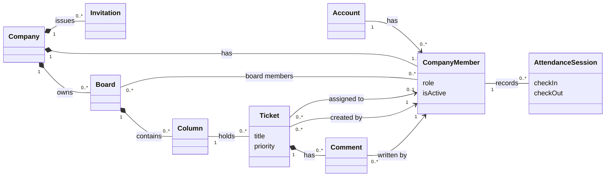

# Ticket Management System

## 1. Project Overview

The Ticket Management System is a multi-tenant web application that helps companies manage internal support requests, tasks, and employee attendance. Each company works in its own isolated space, with its own members, boards, tickets and attendance records. A person has one account and can belong to several companies.

Teams organize their work in boards made of columns, create and assign tickets, move them across columns that reflect their progress, set their priority, and discuss them through comments. Role-based access control determines what each member can see and do within their company. Employees can also check in and check out to record their working sessions, and managers and administrators can review attendance information.

The system is designed API-first: a centralized backend API serves every client. The first client is a web application, while desktop and mobile clients are planned and will consume the same API.

## 2. Goals

The main goals of the system are:

- Allow companies to manage internal tickets and tasks.
- Organize tickets into boards with columns defined by the company.
- Assign tickets to employees.
- Track the progress of tickets through the columns of a board, and their priority.
- Allow users to communicate through ticket comments.
- Provide role-based access control.
- Allow employees to check in and check out.
- Provide managers and administrators with attendance information.
- Support multiple companies within the same application, with strict data isolation.
- Let a person belong to several companies, with a different role in each.
- Expose all functionality through an API, so that desktop and mobile clients can be added without changing the backend.

## 3. Actors

A person has one account and can be a member of several companies. The **role** belongs to the membership, so the same person can be an Employee in one company and a Company Admin in another.

Roles are cumulative: each role can do everything the previous one can, plus more.

### Employee

A company member who works on tickets. Sees only the boards they are a member of, and on those boards creates, edits, moves, assigns and comments on tickets. Checks in and out and sees their own attendance. Cannot manage boards, columns or board members, cannot manage company members, and cannot see other members' attendance.

### Manager

Supervises the work of the company. Sees all boards of the company. Creates and archives boards, manages their columns and board members, archives tickets, and views and corrects the attendance of all members. In the first version a Manager's scope is the whole company. Cannot manage company members or roles.

### Company Admin

Owns the company account. Adds or invites company members, changes their roles and deactivates them, in addition to everything a Manager can do. The person who creates a company becomes its first Company Admin.

### Super Admin (planned)

Manages the platform itself: creates, suspends and deletes companies. Cannot access the tickets, boards or attendance data of any company. Not part of the first version.

## 4. Functional Requirements

Priorities follow MoSCoW: **Must** (first version), **Should** (important, can follow shortly), **Could** (nice to have).

### Company & Authentication

| ID    | Requirement                                                                                           | Priority |
| ----- | ----------------------------------------------------------------------------------------------------- | -------- |
| FR-1  | A visitor can create an account with name, email and password.                                        | Must     |
| FR-2  | The system rejects creating an account with an email that already has one.                            | Must     |
| FR-3  | A user can log in with email and password.                                                            | Must     |
| FR-4  | The system rejects a login with wrong credentials, without revealing whether the email exists.        | Must     |
| FR-5  | A user can log out.                                                                                   | Must     |
| FR-6  | A logged-in user can create a company and becomes its Company Admin.                                  | Must     |
| FR-7  | A user can belong to several companies, with a different role in each.                                | Must     |
| FR-8  | A user who belongs to several companies chooses which one to work in after logging in.                | Must     |
| FR-9  | A user can switch to another of their companies without logging out.                                  | Should   |
| FR-10 | A user who belongs to no company is offered to create one.                                            | Should   |
| FR-11 | A Company Admin can add a person who already has an account to the company, by email and with a role. | Must     |
| FR-12 | A Company Admin can invite a person who has no account yet by email, with a role.                     | Should   |
| FR-13 | An invitation expires after a limited time and can be used only once.                                 | Should   |
| FR-14 | An invited person sets their own password when they accept the invitation.                            | Should   |
| FR-15 | A Company Admin can change the role of a company member.                                              | Must     |
| FR-16 | A Company Admin can deactivate a company member; a deactivated member cannot access that company.     | Must     |
| FR-17 | A user can only access data of the company they are currently working in.                             | Must     |
| FR-18 | A user can change their own password.                                                                 | Should   |
| FR-19 | A user who forgot their password can set a new one through a link sent to their email.                | Should   |

### Boards & Tickets

| ID    | Requirement                                                                                                                                      | Priority |
| ----- | ------------------------------------------------------------------------------------------------------------------------------------------------ | -------- |
| FR-20 | A Manager or above can create a board with a name.                                                                                               | Must     |
| FR-21 | A Manager or above can rename and archive a board.                                                                                               | Must     |
| FR-22 | A Manager or above can add and remove board members, chosen among the members of the company.                                                    | Must     |
| FR-23 | An Employee sees only the boards they are a member of; a Manager or above sees all boards of the company.                                        | Must     |
| FR-24 | A Manager or above can create, rename, reorder and delete the columns of a board.                                                                | Must     |
| FR-25 | A board member can create a ticket in a column with a title, and optionally a description, priority and due date.                                | Must     |
| FR-26 | A board member can edit the details of a ticket.                                                                                                 | Must     |
| FR-27 | A board member can move a ticket to another column or to another position in the same column, and the position is kept after reloading the page. | Must     |
| FR-28 | A board member can assign a ticket to one member of the board, or leave it unassigned.                                                           | Must     |
| FR-29 | A board member can add comments to a ticket and read the comments of others, in chronological order.                                             | Must     |
| FR-30 | A Manager or above can archive a ticket.                                                                                                         | Must     |
| FR-31 | A board member sees changes made by other members without reloading the page.                                                                    | Should   |
| FR-32 | A board member can filter a board to show only the tickets assigned to them.                                                                     | Should   |
| FR-33 | A Manager or above can create a new board by copying the columns of an existing one.                                                             | Could    |

### Attendance

| ID    | Requirement                                                                                                                                                    | Priority |
| ----- | -------------------------------------------------------------------------------------------------------------------------------------------------------------- | -------- |
| FR-34 | A company member can check in, which starts a working session in the company they are working in.                                                              | Must     |
| FR-35 | A company member can check out, which ends their open working session.                                                                                         | Must     |
| FR-36 | The system rejects a check-in while the member already has an open session.                                                                                    | Must     |
| FR-37 | A company member can see their own sessions with start time, end time and duration.                                                                            | Must     |
| FR-38 | A company member can see the total time they worked per day and per week.                                                                                      | Should   |
| FR-39 | A Manager or above can see the sessions of all members of the company, filtered by member and date range.                                                      | Must     |
| FR-40 | A Manager or above can correct the start or end time of a session, for example when someone forgot to check out; each correction records who made it and when. | Should   |
| FR-41 | Sessions that stayed open for more than 24 hours are highlighted to Managers and above.                                                                        | Could    |

## 5. Non-Functional Requirements

| ID     | Category       | Requirement                                                                                                                                            |
| ------ | -------------- | ------------------------------------------------------------------------------------------------------------------------------------------------------ |
| NFR-1  | Data isolation | No request can read or change data of a company the user is not currently working in. This is verified by automated tests with at least two companies. |
| NFR-2  | Security       | Passwords are stored only as salted hashes, and login sessions expire after a limited time.                                                            |
| NFR-3  | Security       | No secret (keys, passwords, connection strings) is stored in the repository.                                                                           |
| NFR-4  | Performance    | Opening a board with up to 200 tickets takes less than 1 second under normal load. This is a target to validate, not a guarantee.                      |
| NFR-5  | Real-time      | A change made by one member appears to the other members viewing the same board within 2 seconds.                                                      |
| NFR-6  | Scalability    | Lists of boards, tickets and sessions are paginated or limited, so response size does not grow without bound.                                          |
| NFR-7  | Reliability    | Errors are returned in one consistent, machine-readable format and never expose internal details.                                                      |
| NFR-8  | Extensibility  | Every feature of the web client is available through the API, so other clients can be built without backend changes.                                   |
| NFR-9  | Time           | Timestamps are stored in UTC and shown in the time zone of the user.                                                                                   |
| NFR-10 | Quality        | Every Must requirement has at least one automated test, and every business rule in section 7 is covered by a test.                                     |
| NFR-11 | Usability      | The web client is usable on screen widths from 360 px (phone) to desktop.                                                                              |

## 6. Domain Model

This section describes the concepts of the business and how they relate. It does not describe tables, columns or data types, which belong to the database design.

### Glossary

| Term               | Meaning                                                                                                                                    |
| ------------------ | ------------------------------------------------------------------------------------------------------------------------------------------ |
| Account            | A person's identity in the system, identified by email. One per person.                                                                    |
| Company            | An organization using the system. Everything it owns is invisible to other companies.                                                      |
| Company Member     | The membership of an account in a company. It holds the role and whether the member is active.                                             |
| Role               | Employee, Manager or Company Admin. Belongs to the company member.                                                                         |
| Invitation         | A time-limited, single-use offer to join a company with a given role.                                                                      |
| Board              | A named container of work inside a company, for example "Route 52".                                                                        |
| Board Member       | A company member who has access to a board.                                                                                                |
| Column             | An ordered stage inside a board, defined by the company (for example "Mon", "Tue", "Extra"). A ticket's progress is the column it sits in. |
| Ticket             | One unit of work on a board, with title, description, priority, optional due date and optional assignee.                                   |
| Comment            | A message written by a company member on a ticket.                                                                                         |
| Attendance Session | A period between a check-in and a check-out of a company member. It is open until the check-out.                                           |

### Concept diagram

Constraints the diagram cannot show are listed in section 7.

## 7. Business Rules

### Company & Membership

- An email identifies exactly one account.
- A person has at most one membership per company.
- The role and the active status belong to the membership, not to the account.
- Deactivating a member does not affect their account or their other memberships, and keeps their history (tickets, comments and attendance).
- A company always keeps at least one active Company Admin.

### Boards & Tickets

- A ticket belongs to exactly one column, and a column to exactly one board.
- A ticket's assignee must be a member of the board.
- Removing a member from a board unassigns their tickets on that board.
- A column that still contains tickets cannot be deleted.

### Attendance

- A company member has at most one open session at a time.
- A check-out cannot be earlier than its check-in.
- A session belongs to one company member, so it is visible only inside that company.

## 8. Permissions

Roles are cumulative. "Board member" applies to Employees, who only act on the boards they belong to; Managers and above act on every board of the company.

| Action                                                  | Employee          | Manager | Company Admin |
| ------------------------------------------------------- | ----------------- | :-----: | :-----------: |
| See boards                                              | Only their boards |   All   |      All      |
| Create, rename, archive boards                          | No                |   Yes   |      Yes      |
| Create, rename, reorder, delete columns                 | No                |   Yes   |      Yes      |
| Add or remove board members                             | No                |   Yes   |      Yes      |
| Create, edit, move and comment on tickets               | On their boards   |   Yes   |      Yes      |
| Assign tickets (to board members)                       | On their boards   |   Yes   |      Yes      |
| Archive tickets                                         | No                |   Yes   |      Yes      |
| Check in and out, see own attendance                    | Yes               |   Yes   |      Yes      |
| See attendance of other members                         | No                |   Yes   |      Yes      |
| Correct attendance sessions                             | No                |   Yes   |      Yes      |
| Add or invite members, change roles, deactivate members | No                |   No    |      Yes      |

## 9. Future Features

- Departments that group boards, and Managers limited to some departments.
- Super Admin role to manage companies and the platform.
- Labels, custom fields, attachments, sub-tasks and limits on work in progress.
- Activity history of every ticket.
- Notifications by email and in the app.
- Retention and anonymization of data of deactivated members.
- Single sign-on (SSO/OAuth) login.
- Desktop client (Electron) and mobile client (React Native).
- Offline check-in with later synchronization on desktop and mobile.

## 10. Open Questions

1. Are archived boards and tickets hidden, or visible in read-only mode?
2. Can a person be checked in to two companies at the same time?
3. Are the days used for worked time computed in the user's time zone or in a time zone chosen by the company?
4. Does a Manager need to be added to a board to see it, or do Managers see every board automatically (as FR-23 states now)?
5. Should a deactivated member still appear as author of their tickets and comments? (Proposed: yes, marked as deactivated.)
6. Does the "created by" of a ticket point to the person's company membership or to the account? (Proposed: the company membership.)
